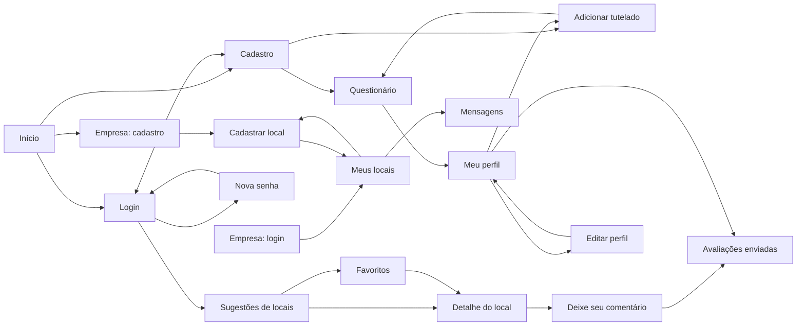

# SenseWay: front-end (HTML + CSS + JS)

Site estático montado a partir das telas do Figma ("Projeto josé benedito").
Os dados vêm de um **banco simulado** (arquivos JSON) por meio de uma camada única de acesso, a parte de dados do `js/app.js`. Quando o back-end existir, só essa parte muda.

## Como rodar

1. Abra a pasta `senseway` no VS Code (File → Open Folder).
2. Clique com o botão direito em `index.html` → **Open with Live Server**.

O site **precisa** do Live Server (ou de outro servidor). Se você abrir o arquivo com dois cliques, o navegador bloqueia a leitura dos JSON.

## Estrutura

```
senseway/
├── index.html              Início
├── pages/                  Área do usuário
│   ├── acesso.html         Entrar | #cadastro (criar conta) | #nova-senha
│   ├── locais.html         Sugestões de locais (busca + favoritar)
│   ├── local.html?id=1     Detalhe do local + mensagem à empresa
│   ├── favoritos.html
│   ├── avaliacoes.html     Avaliações enviadas | #nova (deixe seu comentário; ?local=1 já escolhe o local)
│   ├── perfil.html         Meu perfil | #editar | #tutelado (adicionar tutelado)
│   └── questionario.html   (?tutelado=1 para as preferências de um tutelado)
├── empresa/                Área da empresa
│   ├── acesso.html         Entrar | #cadastro (criar conta)
│   ├── meus-locais.html    Meus locais | #cadastro (cadastrar local; ?id=1#cadastro edita)
│   └── mensagens.html      Caixa de mensagens (chat)
├── css/style.css           Um CSS para o site todo (cores no topo, em :root)
├── js/app.js               Todo o JavaScript: dados, ajudantes, cabeçalho/rodapé e telas
├── data/banco.json         Banco simulado (um JSON só)
└── img/                    Imagens
```

Cada HTML diz qual tela é em `<body data-pagina="...">`. Páginas com várias telas usam `<div data-modo="...">`: o `#` do endereço escolhe qual aparece (sem `#`, aparece a primeira). O cabeçalho e o rodapé são montados pelo `app.js` a partir de `data-area` (`publico`, `usuario`, `empresa`, `empresa-acesso`) e `data-nav` (link ativo).

## Mapa de navegação



O cabeçalho do usuário (Explorar locais, Favoritos, Meu perfil, Área da empresa) e o rodapé aparecem em todas as telas.

## Como os dados funcionam

```
Tela  →  funções de dados do app.js  →  hoje: data/banco.json
                                    amanhã: back-end (API) → banco de dados
```

- As telas **nunca** fazem `fetch` direto. Sempre chamam as funções de dados (parte 1 do `app.js`), como `listarLocais()` e `buscarLocal(id)`.
- No modo `mock`, o que você cria ou altera (favoritos, avaliações, tutelados, locais, respostas) fica guardado na `sessionStorage` e some ao fechar a aba. Isso imita o banco para você testar o fluxo inteiro.
- Para voltar ao estado inicial, feche a aba e abra de novo.

### Trocar pelo back-end real

No topo do `js/app.js`:

```js
const CONFIG = {
  modo: 'api',                          // era 'mock'
  urlApi: 'http://localhost:3000/api'   // endereço do back-end
};
```

Cada função já tem a rota que a API deve oferecer (`GET /locais`, `POST /avaliacoes`, `POST /auth/login`...). O back-end só precisa devolver os dados **no mesmo formato** de cada parte do `data/banco.json`.

## Segurança

- Tudo o que chega ao navegador pode ser visto e alterado pelo F12. A proteção real fica no **back-end**, que confere login, permissões e dados em cada pedido.
- Por isso as senhas nunca são guardadas nos JSON nem conferidas no front. As validações do HTML (`required`, `minlength`, `type="email"`) servem só para o conforto do usuário.
- Todo dado que vira HTML passa por `esc()` (ou `textContent`). Assim, um texto malicioso salvo no banco não vira código na página (ataque XSS).
- Cada página tem uma **Content-Security-Policy**: só roda script do próprio site, só carrega fontes do Google Fonts e só conversa com o próprio site e com a API configurada. Se mudar `urlApi`, atualize o `connect-src` da CSP nas páginas.

## Imagens que você precisa colocar

| Arquivo | Onde aparece |
|---|---|
| `img/logoSenseWay.jpeg` | Logo em todas as telas |
| `img/locais/vila-jambolao.jpg` | Foto da Vila Jambolão |
| `img/locais/cafe-aurora.jpg` | (opcional) |
| `img/locais/praca-harmonia.jpg` | (opcional) |
| `img/locais/biblioteca-novamente.jpg` | (opcional) |
| `img/locais/shopping-nexus.jpg` | (opcional) |

Crie a pasta `img/locais/` para colocar as fotos. Se uma imagem não existir, o site mostra uma imagem padrão (embutida no `app.js`). Para usar outro nome de arquivo, altere o campo `foto` do local em `data/banco.json`.

## Ajustes em relação ao Figma

- O Figma usa "Av. Jambolão Chalé" e "Vila Jambolão" para o mesmo lugar. No banco ficou um nome só, **Vila Jambolão**.
- Foi criada a tela de cadastro (`pages/acesso.html#cadastro`), porque o botão "Cadastrar" do Início não tinha destino.
- "Cadastrar local" ganhou os campos Categoria, Cidade e Recursos de acessibilidade, porque a tela "Meus locais" mostra "Hospedagem · Botucatu, SP".
- "Deixe seu comentário" usa uma lista de locais vinda do banco no lugar do campo de texto livre. Assim, a avaliação fica ligada ao `id` do local.

## Versões

Cada entrega vai para o GitHub em um commit com a mensagem no padrão:

```
senseWay-front-end-atualiza(versão X.Y)
```

| Versão | O que mudou |
|---|---|
| 1.0 | Código enxugado (50 → 16 arquivos), banco simulado em um JSON, cliques e transições suaves, menu com ajuda "?" |
