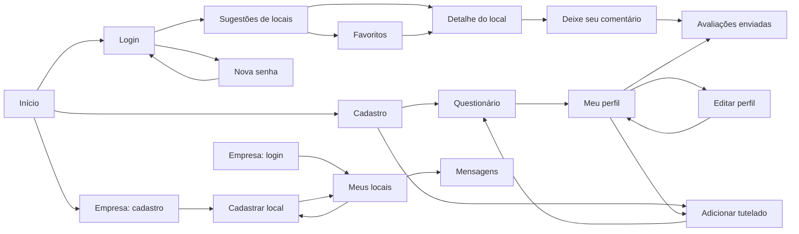

# SenseWay: front-end (HTML + CSS + JS)

Site estático montado a partir das telas do Figma ("Projeto josé benedito").
Os dados vêm de um **banco simulado** (arquivos JSON) por meio de uma camada única de acesso, o `js/api.js`. Quando o back-end existir, só essa camada muda.

## Como rodar

1. Abra a pasta `senseway` no VS Code (File → Open Folder).
2. Clique com o botão direito em `index.html` → **Open with Live Server**.

O site **precisa** do Live Server (ou de outro servidor). Se você abrir o arquivo com dois cliques, o navegador bloqueia a leitura dos JSON.

## Estrutura

```
senseway/
├── index.html              Início
├── pages/                  Área do usuário
│   ├── login.html          Acesse sua conta
│   ├── cadastro.html       Criar conta (não existia no Figma, criada no mesmo estilo)
│   ├── nova-senha.html
│   ├── locais.html         Sugestões de locais (busca + favoritar)
│   ├── local.html?id=1     Detalhe do local + mensagem à empresa
│   ├── favoritos.html
│   ├── comentario.html     Deixe seu comentário (avaliação)
│   ├── avaliacoes.html     Avaliações enviadas (lista ou "sem avaliações")
│   ├── perfil.html
│   ├── editar-perfil.html
│   ├── adicionar-tutelado.html
│   └── questionario.html   (?tutelado=1 para as preferências de um tutelado)
├── empresa/                Área da empresa
│   ├── login.html          Acesse sua empresa
│   ├── cadastro.html       Crie sua conta
│   ├── meus-locais.html
│   ├── cadastrar-local.html  (?id=1 para editar)
│   └── mensagens.html      Caixa de mensagens (chat)
├── css/style.css           Um CSS para o site todo (cores no topo, em :root)
├── js/
│   ├── api.js              ÚNICA porta de entrada dos dados
│   ├── ui.js               Ajudantes: ícones, formulários, segurança no HTML
│   └── paginas/            Um arquivo JS por tela
├── data/                   Banco simulado (JSON)
└── img/                    Imagens
```

## Mapa de navegação



O cabeçalho do usuário (Explorar locais, Favoritos, Meu perfil, Área da empresa) e o rodapé aparecem em todas as telas.

## Como os dados funcionam

```
Tela (ex.: locais.js)  →  api.js  →  hoje: data/*.json
                                    amanhã: back-end (API) → banco de dados
```

- As telas **nunca** fazem `fetch` direto. Sempre chamam funções do `api.js`, como `listarLocais()` e `buscarLocal(id)`.
- No modo `mock`, o que você cria ou altera (favoritos, avaliações, tutelados, locais, respostas) fica guardado na `sessionStorage` e some ao fechar a aba. Isso imita o banco para você testar o fluxo inteiro.
- Para voltar ao estado inicial, feche a aba e abra de novo.

### Trocar pelo back-end real

No topo do `js/api.js`:

```js
const CONFIG = {
  modo: 'api',                          // era 'mock'
  urlApi: 'http://localhost:3000/api'   // endereço do back-end
};
```

Cada função já tem a rota que a API deve oferecer (`GET /locais`, `POST /avaliacoes`, `POST /auth/login`...). O back-end só precisa devolver os dados **no mesmo formato dos JSON** da pasta `data/`.

## Segurança

- Tudo o que chega ao navegador pode ser visto e alterado pelo F12. A proteção real fica no **back-end**, que confere login, permissões e dados em cada pedido.
- Por isso as senhas nunca são guardadas nos JSON nem conferidas no front. As validações do HTML (`required`, `minlength`, `type="email"`) servem só para o conforto do usuário.
- Todo dado que vira HTML passa por `escaparHtml()` (ou `textContent`). Assim, um texto malicioso salvo no banco não vira código na página (ataque XSS).

## Imagens que você precisa colocar

| Arquivo | Onde aparece |
|---|---|
| `img/logoSenseWay.jpeg` | Logo em todas as telas |
| `img/locais/vila-jambolao.jpg` | Foto da Vila Jambolão |
| `img/locais/cafe-aurora.jpg` | (opcional) |
| `img/locais/praca-harmonia.jpg` | (opcional) |
| `img/locais/biblioteca-novamente.jpg` | (opcional) |
| `img/locais/shopping-nexus.jpg` | (opcional) |

Se uma imagem não existir, o site mostra `img/placeholder.svg` no lugar. Para usar outro nome de arquivo, altere o campo `foto` em `data/locais.json`.

## Ajustes em relação ao Figma

- O Figma usa "Av. Jambolão Chalé" e "Vila Jambolão" para o mesmo lugar. No banco ficou um nome só, **Vila Jambolão**.
- Foi criada a tela `pages/cadastro.html`, porque o botão "Cadastrar" do Início não tinha destino.
- "Cadastrar local" ganhou os campos Categoria, Cidade e Recursos de acessibilidade, porque a tela "Meus locais" mostra "Hospedagem · Botucatu, SP".
- "Deixe seu comentário" usa uma lista de locais vinda do banco no lugar do campo de texto livre. Assim, a avaliação fica ligada ao `id` do local.
